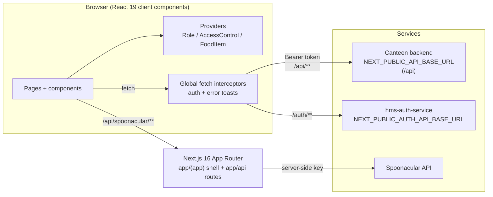
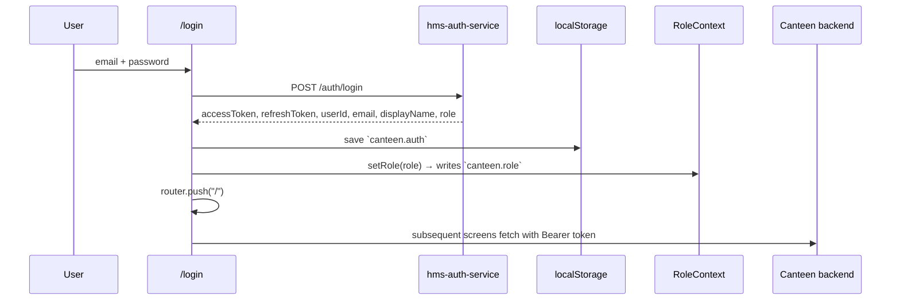
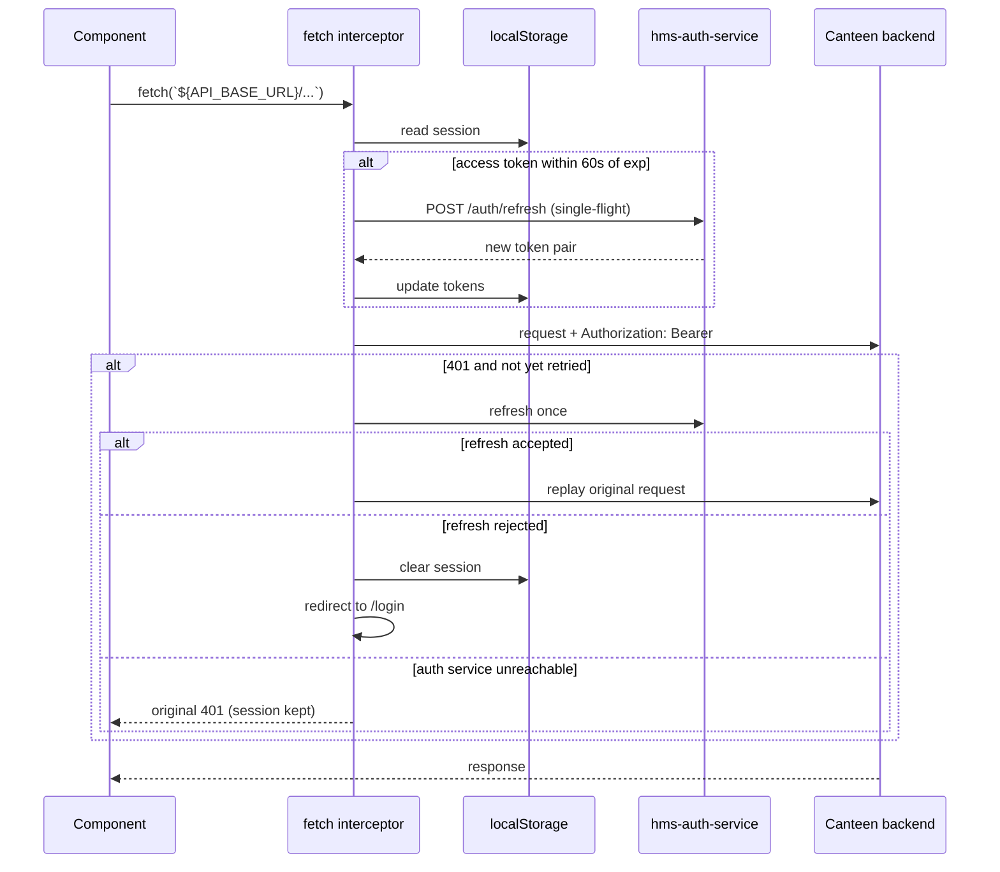
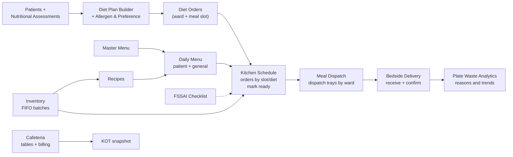

# Canteen Management — Kitchen & Nutrition Hub

A Next.js front end for **hospital inpatient catering** and the **staff cafeteria**. It runs the
whole foodservice loop in one place — nutritional assessment, diet plans, allergen and preference
records, diet orders, kitchen production, meal dispatch, bedside delivery, menus, recipes, FIFO
inventory, FSSAI hygiene checklists, plate-waste analytics, and cafeteria table orders — under a
single role-scoped record per patient and meal.

The app is a **client of live APIs**, not a fixture-backed demo: patient and meal data comes from
the canteen backend, sign-in is delegated to `hms-auth-service`, and the role matrix that decides
navigation and authority is read from the backend's RBAC service.

---

## Contents

- [What the app covers](#what-the-app-covers)
- [Tech stack](#tech-stack)
- [Getting started](#getting-started)
- [Environment variables](#environment-variables)
- [Architecture](#architecture)
- [Authentication and session flow](#authentication-and-session-flow)
- [Authorisation (RBAC) data flow](#authorisation-rbac-data-flow)
- [Data flow](#data-flow)
- [API surface](#api-surface)
- [Route and screen map](#route-and-screen-map)
- [Conventions and gotchas](#conventions-and-gotchas)
- [Known gaps and open questions](#known-gaps-and-open-questions)
- [Documentation index](#documentation-index)

---

## What the app covers

| Area | Screens | What the team does there |
| --- | --- | --- |
| **Overview** | Dashboard | Ward meal flow, diet mix, order compliance, and kitchen workload at a glance. |
| **Clinical nutrition** | Patients, Nutritional Assessments, Diet Plan Builder, Allergen & Preference | Maintain the admitted-patient roster, capture screening/anthropometrics, build therapeutic diet plans, record allergen restrictions and food preferences. |
| **Diet orders & kitchen** | Diet Orders, Kitchen Schedule, Meal Dispatch, Bedside Delivery | Raise and manage diet orders, plan per-slot production, mark trays ready, dispatch to wards, and confirm last-mile handover. |
| **Food production** | Master Menu, Menu, Recipes | Approve the master dish list, build daily patient/general menus per meal slot, and create recipes from inventory ingredients (with optional Spoonacular nutrition lookup). |
| **Analytics** | Plate Waste Analytics | Monitor waste reasons and ward-wise trends. |
| **Store & compliance** | Inventory, FSSAI Checklist | FIFO stock with batch-level expiry and pre-orders; daily hygiene checklist filed against a routine. |
| **Food services** | Cafeteria, Tables | Run the staff cafeteria: table registration with QR self-order, table orders, bill settlement, and printed KOT snapshots. |
| **Administration** | Settings | Edit the role × action matrix and derive which screens each role may open. |

---

## Tech stack

| Concern | Choice |
| --- | --- |
| Framework | **Next.js 16.3.6** (App Router) |
| UI | **React 19.2.8**, **Tailwind CSS v4** (`@import "tailwindcss"`), Lucide icons |
| Language | **TypeScript (strict)**, path alias `@/*` → project root |
| Charts | `chart.js` + `react-chartjs-2` |
| QR codes | `qrcode.react` |
| Lint | **ESLint 9** with flat config (`eslint.config.mjs`) |
| Tests | None configured (deliberately — do not add test commands) |
| Auth provider | `hms-auth-service` (separate Node service, port `8091`) |

---

## Getting started

### Prerequisites

- Node.js 20+ and npm
- The canteen backend reachable over HTTP
- `hms-auth-service` running locally (or a reachable deployment)

### 1. Install

```bash
npm install
```

### 2. Configure environment

```bash
cp .env.example .env
```

Set `NEXT_PUBLIC_API_BASE_URL`, `NEXT_PUBLIC_AUTH_API_BASE_URL`, and (optionally)
`SPOONACULAR_API_KEY`. Without an `.env` file the app falls back to the shared dev tunnel for the
canteen backend and `http://localhost:8091` for auth.

### 3. Run the auth service

The canteen app cannot sign anyone in by itself. In `hms-auth-service/`:

```bash
npm install
npm run dev
```

Seed the dev accounts once (one per role in `Roles.ts`, password `Hygo@1234`):

```bash
npm run seed:canteen-users
```

### 4. Run the app

```bash
npm run dev          # http://localhost:3000
```

Other scripts:

```bash
npm run build        # production build
npm run start        # serve the production build
npm run lint         # ESLint
```

> **Build-time variables.** `NEXT_PUBLIC_*` values are inlined into the browser bundle at build
> time. Change the backend URL → rebuild/redeploy; editing `.env` on a running build is not enough.

---

## Environment variables

| Variable | Required | Read by | Purpose |
| --- | --- | --- | --- |
| `NEXT_PUBLIC_API_BASE_URL` | Recommended | `data/apiBaseUrl.ts` | Canteen backend base URL, **including** the `/api` prefix. Falls back to the shared dev tunnel. |
| `NEXT_PUBLIC_AUTH_API_BASE_URL` | Recommended | `data/authApiBaseUrl.ts` | `hms-auth-service` base URL, **no** `/api` prefix. Defaults to `http://localhost:8091`. |
| `SPOONACULAR_API_KEY` | Optional | `app/api/spoonacular/*` | Server-only key for the recipe search/nutrition proxy. Never prefixed with `NEXT_PUBLIC_`. |

The two API variables must be public because the `data/*/api.ts` modules and the login page are
client components. The Spoonacular key stays on the server and is only used inside Next.js route
handlers.

---

## Architecture

### System context



The browser talks to three distinct surfaces:

1. **Canteen backend** — every domain resource (`/api/inventory`, `/api/dietorder`, …), through the
   global fetch wrapper that attaches and refreshes the bearer token.
2. **Auth service** — only `POST /auth/login` and `POST /auth/refresh`, on its own base URL.
3. **Next.js route handlers** — only the two Spoonacular proxy routes; these exist so the
   provider key never reaches the browser.

### Frontend layering

```
Declarative source of truth
├── routes.ts        sidebar sections, route names/paths/descriptions
└── Roles.ts         roles, ACTIONS, ROLE_ACTIONS matrix, SCREEN_ACTIONS, can()/canAccessPath()

Providers (root)             app/layout.tsx
├── RoleProvider             active role, mirrored from localStorage `canteen.role`
├── NumberInputWheelGuard    stops number inputs from stepping on scroll
└── ToastProvider            global toast stack

App shell                    app/(app)/layout.tsx
└── AuthGate                 redirects signed-out visitors to /login
    └── AccessControlProvider   live role matrix + can()/canAccessPath()
        └── FoodItemProvider    prefetches inventory + recipes when the matrix allows
            ├── Sidebar         renders only accessible sections
            ├── AppHeader       breadcrumb, identity, logout
            └── RoleGuard       blocks routes the role may not open
                └── page        screen-specific state and orchestration
                    └── components/<Domain>/*
                        └── data/<Resource>/api.ts  ──fetch──> API_BASE_URL
```

Every screen follows the same layering rule:

- **Page** (`app/(app)/<screen>/page.tsx`) owns screen state and orchestrates mutations.
- **Components** (`components/<Domain>/*`) are presentational/modal/table pieces.
- **Data module** (`data/<Resource>/api.ts` + `type.ts`) is the only place that knows HTTP verbs,
  URLs, and response shapes.
- **Cross-screen state** lives in `context/*` and is consumed through hooks.

Most pages are `"use client"` because they fetch at runtime with a token stored in the browser. The
root layout and `(app)` shell are server components that compose client providers.

### Directory layout

| Path | Responsibility |
| --- | --- |
| `app/layout.tsx` | `<html>`, fonts, global providers. No app chrome, so `/login` can render full-screen. |
| `app/(app)/layout.tsx` | Signed-in shell: AuthGate → AccessControlProvider → FoodItemProvider → sidebar/header/guard. |
| `app/(app)/<screen>/page.tsx` | One screen per route. `app/(app)/page.tsx` renders the dashboard for `/`. |
| `app/login/page.tsx` | Full-screen sign-in, outside the `(app)` group. |
| `app/api/spoonacular/*` | Server-side proxies for recipe search and nutrition. |
| `components/<Domain>/*` | Tables, modals, forms, summary cards, charts, shared UI. |
| `context/*` | `RoleContext`, `AccessControlContext`, `FoodItemContext`, `MenuContext`, `MenuScheduleContext`. |
| `data/<Resource>/api.ts` | All HTTP calls for a resource. |
| `data/<Resource>/type.ts` | Request/response types and domain shapes. |
| `data/apiBaseUrl.ts` / `data/authApiBaseUrl.ts` | The two configured base URLs (and dev fallbacks). |
| `data/Settings/overrides.ts` | Pure matrix diff/merge helpers used by the Settings screen. |
| `utils/authSession.ts` | localStorage session persistence. |
| `utils/authFetchInterceptor.ts` | Bearer token attachment, proactive refresh, single retry. |
| `utils/apiErrorToasts.ts` | Global error toasts for failed `/api/` requests. |
| `utils/toast.ts` | Tiny toast event bus. |
| `utils/units.ts` | Unit-of-measure helpers. |
| `types/*` | Types for the context contracts. |
| `routes.ts` / `Roles.ts` | Navigation and authority source of truth. |
| `docs/settings-api.md` | RBAC endpoint contract and known backend issues. |
| `hms-auth-service/` | Checked-out auth service (separate git repo). |

### Rendering and request lifecycle

1. `instrumentation-client.ts` runs **after the document loads but before React hydration**. It
   installs the auth interceptor first, then the error-toast interceptor, so auth is the inner
   wrapper and a transparently refreshed 401 never raises a toast.
2. The root layout mounts `RoleProvider`; the `(app)` layout mounts `AuthGate`, the access-control
   provider, and the shared food-item context.
3. `AccessControlProvider` requests the live RBAC matrix. `Sidebar`, `RoleGuard`, and per-screen
   `can()` checks all read that same value.
4. Each screen calls its `data/<Resource>/api.ts` functions. The fetch wrapper attaches
   `Authorization: Bearer <accessToken>`, refreshing shortly before expiry.
5. Failures raise a global toast unless the caller explicitly opts out (`withoutErrorToasts`).

---

## Authentication and session flow

### Sign-in



- `loginApi` (`data/Auth/api.ts`) rejects an account with no valid canteen role; the message is shown
  verbatim.
- The role comes from the token, not from a picker. The header displays it; it cannot be switched
  client-side.
- `AuthGate` redirects any visiting session-less user to `/login`; `/login` redirects an existing
  session back to `/`.
- Stored keys:
  - `canteen.auth` — tokens + identity (`utils/authSession.ts`).
  - `canteen.role` — mirrored role for `RoleContext`, the sidebar, and the guard.

> Tokens live in `localStorage`; there is no httpOnly cookie yet. Treat this as a known security
> trade-off of the current auth contract.

### Authenticated request and refresh



Design points in `utils/authFetchInterceptor.ts`:

- Only URLs containing `/api/` are touched, so `/auth/login` and `/auth/refresh` never recurse.
- Refresh is **single-flight**: concurrent screen requests share one refresh call.
- A request is retried **at most once**.
- A network failure is *not* proof the refresh token is dead — the session survives.
- A 400/401/403 refresh response is treated as a genuinely expired session and forces sign-in.

**Sign-out** (`AppHeader`) clears both storage keys and navigates to `/login`; `AuthGate` keeps every
app route closed.

---

## Authorisation (RBAC) data flow

### The model

Access is one data-driven matrix with two derived views:

| Concept | Location | Meaning |
| --- | --- | --- |
| `ROLES` | `Roles.ts` | `Admin`, `Kitchen Manager`, `Supervisor`, `Dietitian`, `Nurse`, `Store Keeper`, `Cashier` |
| `ACTIONS` | `Roles.ts` | 18 permission-carrying ids (e.g. `manageDietOrders`, `adjustInventory`, `manageSettings`) |
| `ROLE_ACTIONS` | `Roles.ts` | `action → role → permission`; a missing cell means `"no"` |
| `SCREEN_ACTIONS` | `Roles.ts` | Which action(s) each route requires |
| Permissions | `Roles.ts` | `yes` / `may be` grant, `request` grants nothing today, `no` denies |

**A screen is open when the role holds `yes` or `may be` for at least one of its actions.** There is
no separate hand-maintained screen list per role, so the sidebar, the route guard, and action checks
cannot disagree. `Admin` is exempt and always answers `"yes"`.

### Runtime resolution

```
Roles.ts ROLE_ACTIONS (built-in defaults)
        │
        ▼
AccessControlProvider on mount / tab visible
        │  GET /api/rbac/permissions
        ▼
{ defaults, overrides, live, roles, actions, permissions }
        │
        ├── live  ──> matrix in force (replaces built-in)
        ├── roles/actions/permissions ──> Settings headers
        │
        ├── Sidebar.getAccessibleSections()   → only open screens render
        ├── RoleGuard.canAccessPath(pathname) → blocked routes show a no-access panel
        └── can(actionId)                     → per-button / per-fetch authority
```

- If the API answers, the backend's `live` matrix replaces the built-in one (`source: "backend"`).
- If the API is unreachable or refuses the role, the built-in matrix stays in force
  (`source: "defaults"`), and both the sidebar and the guard say the answer may be stale rather
  than silently shrinking navigation.
- A tab that stays open re-reads the matrix on `visibilitychange` (silent refresh), so an admin's
  change reaches other tabs without a reload.
- `FoodItemProvider` asks `can()` before fetching inventory/recipes, so a role without the row never
  triggers a 403 toast on every screen.

### Settings write flow

1. The admin edits a **draft** matrix on `/settings`.
2. The screen diffs the draft against the live matrix and sends **only changed cells**:
   `PUT /api/rbac/permissions` with `{ roleActions: patch }` (partial merge).
3. The response echoes the saved `live` matrix; the provider adopts it and merges the same cells into
   its stored `overrides`.
4. `POST /api/rbac/permissions/reset` drops every override and falls back to `defaults`.
5. Turning a screen **on** grants only its **primary** action; turning it **off** sets **every**
   action on that screen to `"no"`.

The full contract, payloads, and backend caveats are documented in
[`docs/settings-api.md`](docs/settings-api.md). Today the RBAC routes are Admin-only, which is why
non-admin roles may see the built-in matrix and an "access list unavailable" warning; that gap is
explained there.

---

## Data flow

### 1. Read path — a screen loads

Example: Inventory.

```
Inventory page mounts
  ├── getInventorySummaryApi()           GET /inventory/summary
  └── getInventoryItemsApi({page, limit, search})
                                          GET /inventory?page=&limit=&search=
        └── response envelope { statusCode, message, success, data }
              └── rows + pagination → table state
                                     → summary cards
FoodItemProvider (app shell)
  └── getInventoryItemsApi({limit:100})  prefetches the broader list used by
                                          the batch picker and recipe form
```

The page keeps **two inventory views**: its own server-paginated table slice (`page`, `limit`,
`search`) and the context's broader list (up to 100 items) for pickers. Mutations refresh both.

### 2. Write path — a mutation

```
User submits a modal
  └── page handler (e.g. handleAddBatch)
        ├── data/<Resource>/api.ts mutation   POST /inventory/:id/batch
        │     └── throws on !response.ok so the modal can show the server message
        ├── modal closes
        └── refresh list + summary            re-fetch the affected endpoints
```

Conventions across resources:

- Mutations **throw** on failure; the modal stays open and surfaces the API message.
- Lists refresh from the server after a write rather than being patched optimistically.
- Delete flows use a confirmation modal and then re-fetch the list and summary counters.
- The global toast layer announces non-2xx responses; screens that show the error inline opt out
  with `withoutErrorToasts`.

### 3. Shared state between screens

| Provider | Mount point | Holds | Consumed by |
| --- | --- | --- | --- |
| `RoleProvider` | root layout | active role from `canteen.role` | header identity, sidebar, guard, access checks |
| `AccessControlProvider` | `(app)` shell | live matrix, defaults, overrides, status/source, `can()` helpers | sidebar, guard, Settings, FoodItemContext |
| `FoodItemProvider` | `(app)` shell | inventory items (≤100) + recipes | inventory batch picker, recipe form, inventory page refresh |
| `MenuProvider` | `menu`, `mastermenu` pages | master-menu items | menu/master-menu screens |
| `MenuScheduleProvider` | `menu`, `kitchen-schedule` pages | patient and general menus | menu and kitchen-schedule screens |
| `ToastProvider` | root layout | toast queue | every screen |

`MenuProvider` and `MenuScheduleProvider` are intentionally page-scoped, not global: only the menu
screens need them and they should not fetch on unrelated routes.

### 4. The inpatient meal lifecycle

The operational record is threaded across screens. Each screen owns its step and the next one reads
the result:



**Clinical nutrition** decides *what* a patient may eat (diet type, allergens, preferences);
**diet orders** pin that to a patient, ward, and meal slot; **kitchen schedule** turns orders into
production; **dispatch** and **bedside delivery** move trays; **plate waste** closes the loop. Menus,
recipes, and inventory are the production inputs. The **cafeteria** is a separate service with its
own table/order/settlement flow.

### 5. External nutrition lookup

```
Recipe modal (client)
  └── data/Recipe/spoonacular.ts
        ├── GET /api/spoonacular/search?q=...     (Next.js route handler)
        └── GET /api/spoonacular/nutrition?id=... (Next.js route handler)
              └── server adds SPOONACULAR_API_KEY → api.spoonacular.com
                    └── returns id/title/image or nutrition fields only
```

Any failure returns `undefined`; the modal falls back to manual entry instead of breaking.

---

## API surface

Every resource module follows the same pattern: `data/<Resource>/api.ts` exports typed functions and
`type.ts` holds the shapes. All backend paths are relative to `NEXT_PUBLIC_API_BASE_URL`, which
already ends in `/api`.

| Resource | Module | Endpoints |
| --- | --- | --- |
| Dashboard | `data/Dashboard` | `GET /dashboard`, `GET /dashboard/orders` |
| Patients | `data/Patient` | `GET /patients`, `GET /patients/summary`, `GET /patients/:uhid` |
| Assessments | `data/Assessment` | `GET/POST /assessments`, `PUT/DELETE /assessments/:id`, `GET /assessments/summary` |
| Diet plans | `data/DietPlan` | `GET/POST /dietplan`, `PUT/DELETE /dietplan/:id`, `GET /dietplan/summary` |
| Allergens & preferences | `data/AllergyPref` | `GET/POST /allergypref`, `PUT/DELETE /allergypref/:id`, `GET /allergypref/summary` |
| Diet orders | `data/DietOrder` | `GET/POST /dietorder`, `PUT/DELETE /dietorder/:orderId`, `GET /dietorder/summary`, `GET /dietorder/paitent` (patient search, backend spelling) |
| Kitchen schedule | `data/KitchenSchedule` | `GET/POST /kitchenschedule`, `GET /kitchenschedule/summary`, `GET /kitchenschedule/orders`, `PUT /kitchenschedule/orders/ready`, `PUT /kitchenschedule/orders/:orderId/ready` |
| Meal dispatch | `data/MealDispatch` | `GET /mealdispatch/summary`, `GET /mealdispatch/pending`, `PUT /mealdispatch/:orderId/dispatch` |
| Bedside delivery | `data/BedSideDelivery` | `GET/POST /bedsidedelivery`, `PUT /bedsidedelivery/:order_id`, `GET /bedsidedelivery/orders`, `GET /bedsidedelivery/summary` |
| Plate waste | `data/PlateWaste` | `GET /platewaste`, `GET /platewaste/summary`, `GET /platewaste/diettype` |
| Master menu | `data/MasterMenu` | `GET /mastermenu`, `PUT /mastermenu/:master_item_id` |
| Daily menu | `data/Menu` | `GET/POST /menu`, `PUT/DELETE /menu/:menu_id?type=` |
| Recipes | `data/Recipe` | `GET/POST /recipe`, `PUT/DELETE /recipe/:recipe_id` |
| Inventory | `data/Inventory` | `GET/POST /inventory`, `GET /inventory/summary`, `PUT/DELETE /inventory/:item_id`, `POST /inventory/:item_id/batch`, `PUT /inventory/:item_id/po` |
| FSSAI checklist | `data/FssaiChecklist` | `GET/POST /fssaichecklist`, `PUT /fssaichecklist/:checklist_id/toggle`, `GET /fssaichecklist/summary` |
| Cafeteria | `data/Cafeteria` | `GET /cafeteria/summary`, `POST/PUT/GET /cafeteria/table` |
| Tables | `data/Tables` | `GET /table`, `POST /table` |
| Access control | `data/Settings` | `GET/PUT /rbac/permissions`, `POST /rbac/permissions/reset` |
| Auth (separate base URL) | `data/Auth` | `POST /auth/login`, `POST /auth/refresh` |
| Spoonacular proxy (this app) | `data/Recipe/spoonacular.ts` | `GET /api/spoonacular/search`, `GET /api/spoonacular/nutrition` |

### Response envelope

The canteen backend answers in a consistent envelope:

```json
{
  "statusCode": 200,
  "message": "OK",
  "success": true,
  "data": {}
}
```

`data` holds the payload; `message` carries the human-readable failure reason, which screens show
verbatim. Inventory's list endpoint is doubly nested (`data.data` + `data.pagination`); its client
tolerates both shapes. The error-toast interceptor understands both `message` strings and Nest-style
message arrays.

---

## Route and screen map

Navigation is declared once in `routes.ts`. A screen's actions come from `SCREEN_ACTIONS` in
`Roles.ts`; the guard uses the same mapping.

| Section | Route | Screen | Action(s) that open it |
| --- | --- | --- | --- |
| Overview | `/` | Dashboard (also `/dashboard`) | `viewDashboard` |
| Clinical Nutrition | `/patients` | Patients | `viewPatients` |
| Clinical Nutrition | `/assessments` | Nutritional Assessments | `manageAssessments` |
| Clinical Nutrition | `/diet-plan` | Diet Plan Builder | `changePatientDiet` |
| Clinical Nutrition | `/allergens` | Allergen & Preference | `manageAllergens` |
| Diet Orders & Kitchen | `/diet-orders` | Diet Orders | `manageDietOrders` |
| Diet Orders & Kitchen | `/kitchen-schedule` | Kitchen Schedule | `planKitchenSchedule` |
| Diet Orders & Kitchen | `/meal-dispatch` | Meal Dispatch | `dispatchDeliveryMeal` |
| Diet Orders & Kitchen | `/bedside-delivery` | Bedside Delivery | `dispatchDeliveryMeal` |
| Food Production | `/mastermenu` | Master Menu | `approveMasterMenu` |
| Food Production | `/menu` | Menu | `manageMenus` |
| Food Production | `/recipe` | Recipes | `manageRecipes` |
| Analytics | `/plate-waste` | Plate Waste Analytics | `viewPlateWaste` |
| Store & Compliance | `/inventory` | Inventory | `adjustInventory` |
| Store & Compliance | `/fssai-checklist` | FSSAI Checklist | `manageFssaiChecklist` |
| Food Services | `/cafeteria` | Cafeteria | `registerTable`, `settleCafeteriaBill` |
| Food Services | `/tables` | Tables | `placeTableOrder`, `registerTable` |
| Food Services | `/tables/[table_id]` | Table order detail | inherits `placeTableOrder` |
| Administration | `/settings` | Settings | `manageSettings` |
| — | `/login` | Sign-in (outside the app shell) | none |

**To add a screen:** create `app/(app)/<path>/page.tsx`, add an entry to `SIDEBAR_ROUTES` in
`routes.ts`, and map at least one action to it in `SCREEN_ACTIONS` in `Roles.ts`. Adding an action
also means adding a row to `ROLE_ACTIONS`; Admin needs no entry and is always allowed.

---

## Conventions and gotchas

- **One API base URL.** Every fetch goes through the `data/*/api.ts` modules and `API_BASE_URL`.
  Point the app at another backend by changing one environment variable — no code edits.
- **Build-time inlining.** `NEXT_PUBLIC_*` values are baked into the client bundle. A changed
  `.env` requires a rebuild.
- **Dev fallback tunnel.** With no `.env`, `API_BASE_URL` falls back to a shared dev tunnel. Never
  ship a production build without explicitly setting the variable.
- **Token scope.** The auth interceptor only touches URLs containing `/api/`, so auth-service calls
  never carry a canteen token or recurse into refresh.
- **Error handling is global.** Failed `/api/` requests raise a toast even when the caller swallows
  the error; use `withoutErrorToasts` only when the screen shows the failure inline.
- **No optimistic writes.** Screens re-fetch the affected list/summary after a mutation so the UI
  cannot drift from the server.
- **Tailwind v4.** Use `@import "tailwindcss"` in `app/globals.css`; do not reintroduce
  `@tailwind base/components/utilities`.
- **Path alias.** `@/*` resolves to the project root (`./*`), not `src/`.
- **`reactStrictMode` is `false`** in `next.config.ts`.
- **No test framework.** Do not add test scripts; verify with `npm run lint` and `npm run build`.
- **Mock data is a dev fallback only.** `data/Inventory/dummyData.ts` supplies category labels and
  local fallbacks, not production content.
- **Patient data is sensitive.** Treat identifiers accordingly; the product owner has not confirmed
  whether real patient data is present.

---

## Known gaps and open questions

These are documented constraints of the current backend contract, not frontend bugs:

1. **RBAC read is Admin-only.** `GET /api/rbac/permissions` is guarded by `roles: ["Admin"]`, so a
   non-admin role cannot read the matrix its own sidebar is built from. The app falls back to
   `Roles.ts` and warns that navigation may be incomplete. Two fixes are proposed in
   [`docs/settings-api.md`](docs/settings-api.md): open the GET to any signed-in caller, or add a
   `GET /rbac/permissions/me` returning only the caller's row.
2. **`request` grants nothing.** There is no approval workflow yet, so a cell marked `request` is
   treated as denied until an approval flow exists.
3. **No per-cell delete.** Returning a cell to its default stores an override equal to the default,
   which the UI then marks "custom" forever. Only a whole-matrix reset clears overrides.
4. **No per-user role assignment.** The former users/roles tab is gone because
   `GET /settings/users` and `PATCH /settings/users/:user_id` do not exist. `roleFromClaims` maps
   HMS claim strings to canteen roles, but no screen edits it yet.
5. **No httpOnly cookie.** Session tokens live in `localStorage`, following the auth service's
   token-in-response contract.
6. **Deployment target is undecided.** Set both `NEXT_PUBLIC_*` variables in the host environment and
   rebuild.
7. **Product questions open.** FSSAI obligations vs internal standard, final branding, and the shape
   of the approval flow are unresolved. `PRODUCT.md` records them explicitly.

---

## Documentation index

| Document | Contents |
| --- | --- |
| [`PRODUCT.md`](PRODUCT.md) | Users, purpose, operating context, confirmed constraints, product principles. |
| [`AGENTS.md`](AGENTS.md) | Stack conventions, commands, API/auth notes, and gotchas for agents. |
| [`docs/settings-api.md`](docs/settings-api.md) | Full RBAC contract, matrix semantics, and open backend issues. |
| [`hms-auth-service/README.md`](hms-auth-service/README.md) | Auth service endpoints, environment, and run instructions. |
| [`.env.example`](.env.example) | Every environment variable the app reads. |
| [`routes.ts`](routes.ts) | Sidebar hierarchy and route metadata. |
| [`Roles.ts`](Roles.ts) | Roles, actions, built-in matrix, and screen→action mapping. |
